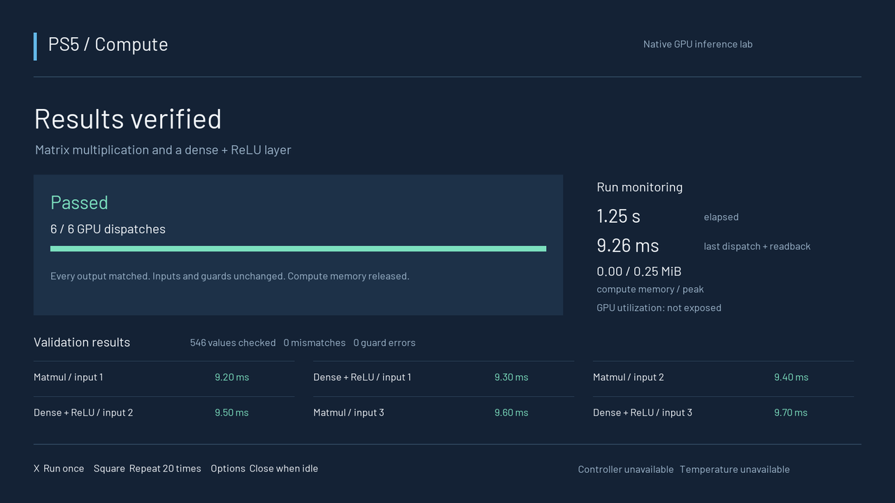

# PS5 Compute

**Native PS5 GPU compute experiments with a launchable console dashboard and a local browser dashboard.** Runs on the PS5's native OS, without Linux on the console.

The current workload validates FP32 matrix multiplication and a dense layer with bias + ReLU on the GPU. A hardware run completed **120 GPU dispatches and 10,920 exact output matches**, with no output, input, or guard errors.

This is an experimental foundation for native ML inference. **ExecuTorch, arbitrary model loading, PyTorch, training, and LLM inference are not implemented.**



*Host-rendered preview of the native UI with illustrative values; not a TV capture or benchmark.*

## What works

| Component | Status |
| --- | --- |
| FP32 matmul and dense + ReLU | Validated on PS5 GPU; six dispatches per suite |
| Native dashboard | 1080p CPU-rendered VideoOut UI; console display flip confirmed |
| Browser dashboard | Live progress, per-case results, completed-run history, launch and task controls |
| Validation | Poisoned outputs, CPU reference, input/guard checks, independent exact-rational host verifier |
| Controller | Initialization and handle creation succeeded; physical buttons still unverified |
| GPU utilization / temperature | Unavailable; never estimated from task progress |
| Framework/model execution | Future work; no `.pte`, ONNX, or trained model runner |

The recorded hardware result used build `dc0fdb9108332f34` on a CFI-1215A running firmware `12.700.001`. It predates the public packaging changes. See [validation evidence and limits](docs/validation.md) for the precise scope and a sanitized, independently checkable readback trace. A firmware version in this table does not establish homebrew availability on another console.

## Requirements

- **Host:** macOS with Xcode command-line tools, Git, Python 3.12, LLVM 18, `glslangValidator`, and `spirv-val`. macOS is the tested build host; other hosts are unverified.
- **Console:** an already working PS5 homebrew environment that can launch native titles. This repository does not install an exploit or enable homebrew on a retail console.
- **Deployment integration:** ShadowMount scanning `/data/homebrew`, `ftpsrv` on port 2121 with its `SELF` toggle, and `shsrv` on port 2323 with `ps` and `launch` commands. Other loaders require manual integration.
- Host and console on the same trusted local network. The bridge expects the existing FTP/shell services without authentication; do not expose those services to the Internet.

Only source, an open font, and sanitized validation evidence are published. No game files, console keys, firmware, proprietary SDK, or prebuilt console application is included.

## Build

```sh
git clone https://github.com/LEE-CHENYU/ps5-compute.git
cd ps5-compute

# Install Xcode command-line tools first if needed: xcode-select --install
brew install python@3.12 llvm@18 glslang spirv-tools
python3.12 -m venv .venv
source .venv/bin/activate
python -m pip install -r requirements.txt

export LLVM_CONFIG="$(brew --prefix llvm@18)/bin/llvm-config"
python bootstrap.py
python build.py --dashboard
```

`bootstrap.py` fetches exact public source revisions into ignored `vendor/` directories, downloads the checksum-pinned [community PS5 payload SDK v0.43](https://github.com/ps5-payload-dev/sdk/releases/tag/v0.43), and builds PSBC. The first compiler build takes several minutes. Existing dependency checkouts are never reset automatically.

To use your own SDK, set `PS5_PAYLOAD_SDK` to its extracted directory **before both bootstrap and build**. `PS5_CLANG` and `HOST_CXX` can override compiler executables. LLVM must be version 18. After changing SDK/toolchain, run `python bootstrap.py --clean-compiler` and remove `vendor/ps5-native-app-boilerplate/build/host` before rebuilding. Upstream Makefiles assume checkout/SDK paths without spaces.

Build modes:

| Command | Output behavior |
| --- | --- |
| `python build.py --dashboard` | Persistent console UI; waits for tasks |
| `python build.py` | Finite six-dispatch validation suite |
| `python build.py --preflight` | Device initialization check without GPU dispatches |

All modes write `dist/PPSA99991/` and `build/manifest.json`. The manifest records source revisions and file hashes. Each build verifies the foundation's clean-room runtime digest. Dependency source pins live in [dependencies.py](dependencies.py); the SDK and compiler are community tools, not Sony's proprietary SDK.

## Install and launch on PS5

1. Close all games and other homebrew titles; leave the console at its home screen.
2. Copy the example settings and fill in your console's address:

   ```sh
   cp config.example.json config.local.json
   # Edit ps5_host in config.local.json; keep this file private.
   ```

3. With the console's FTP, shell, and ShadowMount services active:

   ```sh
   python run_console.py --seconds 8
   ```

The uploader stages and SHA-256 readback-verifies the application, registers `/data/homebrew/PPSA99991`, and requests `launch PPSA99991`. The home-screen title is **PS5 Compute**. Title ID `PPSA99991` must be unused for the first install; the script refuses to overwrite an existing directory by default.

| PS5 control | Action |
| --- | --- |
| Cross | Run one suite: 6 dispatches, 546 outputs |
| Square | Run 20 suites: 120 dispatches, 10,920 outputs |
| Options | Close the dashboard when idle |

The browser can submit tasks if controller input is unavailable. Do not send this signed native title to an ELF payload loader; it must be launched as a registered native application.

For a later build, fully close the app, then use `python run_console.py --update-installed --seconds 8`. It verifies the installed manifest, backs up the previous files under `/data/ps5-ml/`, and readback-verifies replacements while preserving the directory used by ShadowMount. Updates replace files individually, **not as one all-or-nothing transaction**; keep the app closed until an update finishes. Interrupted or unexpected file states require inspection before retrying.

`--reuse-installed` verifies and launches the current build without uploading it. `--resume-staging` reuses an unfinished staging directory and verifies existing files; a truncated file is reported, not silently accepted. Finite compute tests should use the default 45-second capture window instead of the dashboard's 8 seconds.

## Open the browser dashboard

```sh
source .venv/bin/activate
python web/server.py
# Open http://127.0.0.1:8894
```

On macOS, double-click **Launch Dashboard.command**, or create a normal app launcher:

```sh
python tools/install_mac_launcher.py
open "$HOME/Applications/PS5 Compute Dashboard.app"
```

The launcher keeps the bridge in the current user's `launchd` session as `local.ps5compute.bridge`; it does not install a login item. Stop it with `launchctl remove local.ps5compute.bridge`. Keep the checkout in place, or reinstall the launcher after moving it.

The bridge binds only to `127.0.0.1:8894`, reads `/data/ps5-ml/status.json`, and queues only the predefined one-suite and 20-suite tasks. Its launch button refuses to launch over a running game. An unchanged console heartbeat becomes stale after five seconds; cached results remain visibly offline. Request tokens protect task submission. Local history is stored in ignored `web/state/`.

Environment overrides: `PS5_HOST`, `PS5_FTP_PORT`, `PS5_SHELL_PORT`. For the macOS launcher, prefer `config.local.json`, since Finder does not inherit a terminal's environment.

## Verify and develop

```sh
python -m unittest discover -s tests -v
python tools/verify_results.py docs/evidence/gpu-readback-20-suites.txt.gz
# After your own console run:
python tools/verify_results.py runs/<capture-directory>/console.log
```

The independent verifier requires every expected output and case, six distinct completion tokens per suite, zero reported errors, and a final pass marker. It recomputes outputs with rational arithmetic rather than trusting the device's printed reference values. CI runs these host checks; it cannot execute PS5 GPU work.

The GPU path is GLSL → SPIR-V → PSBC/ACO → native AGC submission through the pinned `ps5-vulkan` compute backend. There is no CPU fallback for dispatch results. The dashboard itself is CPU-rendered and has a separate 32 MiB display allocation.

| Location | Purpose |
| --- | --- |
| `src/main.c`, `shaders/dense.comp` | GPU workload, synchronization, numerical and buffer validation |
| `src/dashboard.c`, `src/dashboard_draw.c` | Native UI, worker thread, controller and status/command files |
| `web/` | Local HTTP bridge and browser UI |
| `build.py`, `bootstrap.py`, `dependencies.py` | Pinned dependencies, compiler build, native packaging |
| `run_console.py` | Scoped deployment, backup, transfer verification and launch |
| `tools/verify_results.py` | Independent readback verifier |

**Next milestone:** audit the Vulkan operations needed by one small exported model, then implement and validate a model runner. Passing these fixed kernels alone does not demonstrate ExecuTorch compatibility.

## License and credits

Project code is [GPL-3.0-or-later](LICENSE). The bundled Barlow font is under [SIL OFL 1.1](assets/fonts/OFL.txt). The native driver, compiler and application foundation come from the projects credited in [THIRD_PARTY_NOTICES.md](THIRD_PARTY_NOTICES.md), including `ps5-vulkan`, `opengnm-psbc`, `ps5-agc-gears`, and `ps5-native-app-boilerplate`. Their source and license notices are retained in fetched checkouts. This is an independent homebrew project, unaffiliated with Sony.
